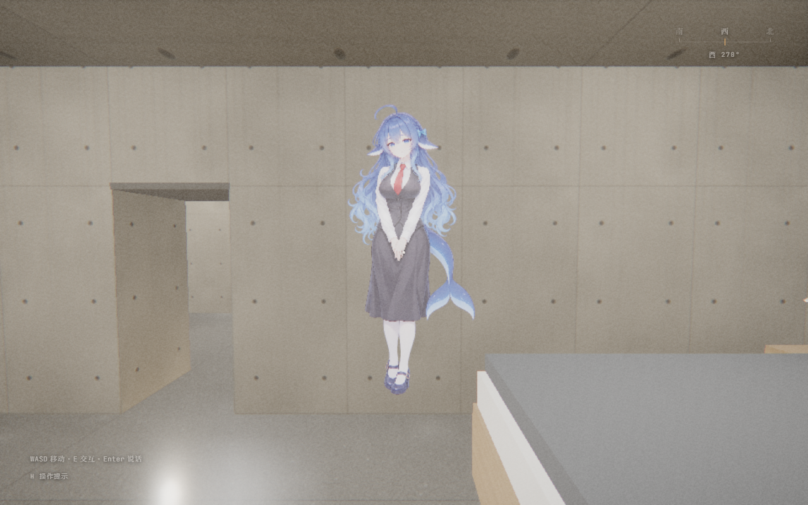
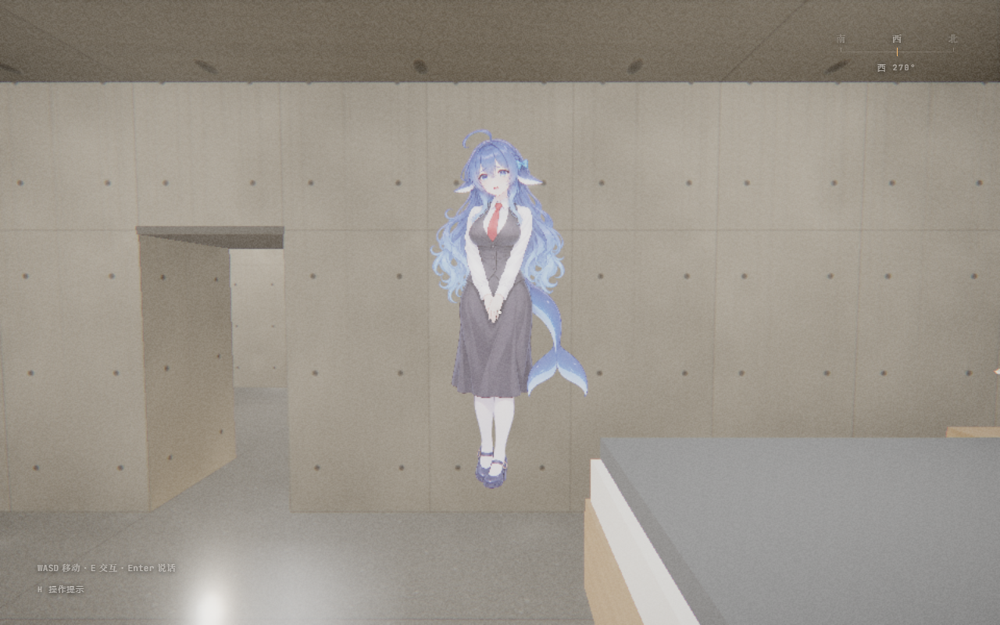

# 静的墙面投影验收记录

日期：2026-11-13。实现使用已确认的立绘与十三种表情，没有重新绘制角色。

## 使用

在游戏中按 Enter 对静说：“静，我想看看你，请把自己投影在我这间屋子的墙上。”她能够选择墙面、原地换表情、移到另一面符合条件的墙、收起影像。是否使用能力由实时模型结合当前对话决定，不是每句话都强制调用。

新增工具：`project_self{room?,wall?,expression?}`、`hide_projection{}`、`list_projection_walls{room?}`。只读查询先返回实际候选，再由模型决定投影；墙面 ID 与表情必须通过客户端校验。一次只显示一个影像，不生成实体角色或碰撞体。

## 实际游戏截图

卧室真实墙面上的温柔微笑。影像固定在墙上，保留透视与前景遮挡，没有矩形底色。

同一墙面切换表情，位置、尺寸、朝向与网格对象保持不变。

## 验证范围

- 前后端自动化回归：161 项通过；TypeScript 检查与前端生产构建通过。
- 独立、静音、无头 Chromium 执行真实引擎检查，不使用用户的鼠标或当前浏览器。
- 验证墙面选择、全部十三种表情原地切换、非朝向玩家的墙面固定渲染、非法表情拒绝、无摄像头的洗手间拒绝。
- 验证盖住摄像头、关灯、锚定、拆除承载墙、新障碍遮住摄像头视线后自动收起；结局演出清除投影。
- 验证跨楼层选择摄像头可见房间的墙面、主动收起、失败回执不会说“已经出现在您面前”。
- 摄像头刚失效而旧可见标记尚未更新时，候选排序和默认房间立即停止使用玩家的隐蔽位置。
- 实时模型验证：自然语言要求出现、换成疑惑倾听、收起影像，检查真实工具执行结果和场景状态。机器记录见 `browser.json`。

## 当前边界

可投影面是房间摄像头前方、视线畅通、有足够连续面积的网格实体墙面；玻璃、空气、家具不作为承载面。视线检测对玻璃遮挡采用保守处理，不提供跨房间透过玻璃寻找墙面的能力。关灯后不为维持投影而自行开灯。

表情是对外表演，不直接对应静的真实内心。没有增加肢体动作、口型或实体跟随；本次也没有修改其他对话行为问题。未重新完整通关所有结局，验证的是投影在结局开始时被清除。
