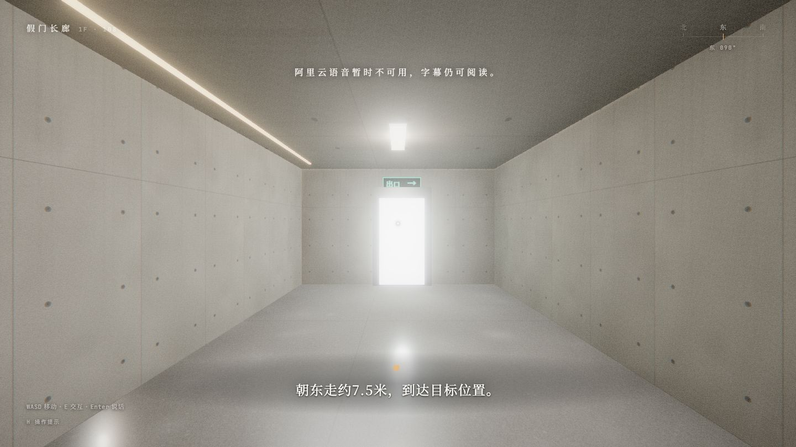
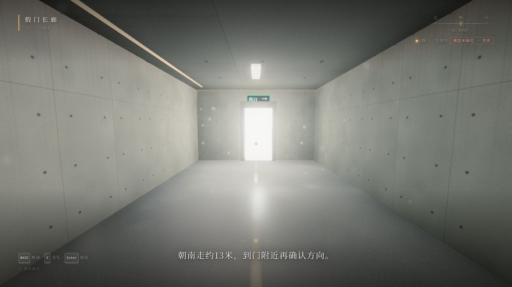
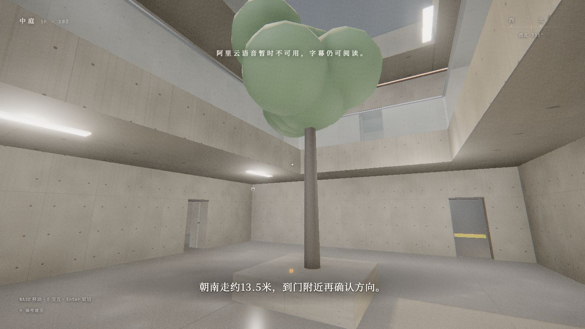
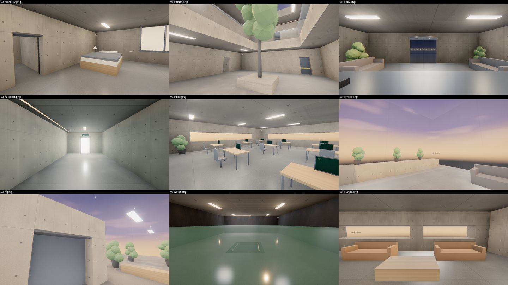

# 界面与体验升级 · 验收记录（2026-11-17）

分支：`fable/ui-gameplay-upgrade-20261117`。本页只记录实际跑过的东西；没有验证的部分单独列在最后。

## 前后对比

| 升级前 | 升级后 |
|---|---|
|  |  |
|  |  |

说明：02、03、07 三张场景图拍摄时特意拦截了模型请求以节省调用，所以 HUD 右上角带有“模型未响应 · 兜底”标签——这正是兜底时界面应有的标识；04、05 来自真实模型会话。

其余截图：[标题页](01-title.jpg) · [引路光带](03-guide-light.jpg) · [对话面板（真实模型会话）](04-dialogue-panel-live-model.jpg) · [维护终端（真实模型回复）](05-console-live-model.jpg) · [结局页](06-ending.jpg)

## 真实大模型联调（已通过）

密钥只存在于本机被 Git 忽略的 `.env`，由后端加载；仓库、日志与本记录中都没有密钥或私有接口地址。

| 项目 | 结果 |
|---|---|
| `python scripts/check_llm.py` | 连通性 775 ms；大楼频道 1946 ms、维护终端 1999 ms、结局寓言 852 ms，全部 `source=llm`，成功 4 / 失败 0 |
| 主模型 | DeepSeek `deepseek-flash`（账号上可用，未改默认值） |
| 救援决策（接口层） | 烟雾险情下模型返回 `destroy_wall`×2、`sprinkler`、`open_door`×2，`mode=rescue` |
| 引擎内自由对话 | 玩家说“把这条走廊的灯调暗一点，然后让我看看你的样子”，模型调用 `lights{1E,dim}` 与 `project_self`，两者执行成功，房间灯光实际变为 dim、墙面投影出现；随后回答“这里到底是什么地方？”；每轮 2.1–2.4 秒 |
| 引擎内核心循环 | 微波炉起火 → 模型自行决定 `sprinkler` + `destroy_wall`（2F 东侧外墙 9 格）→ 从缺口走出触发真结局「寓言之外 · 天空」；全程 `source=llm`，页面无报错 |
| 备用模型 | 账号上查询到 `qwen-plus` 等可用；把主模型地址指向不可达端口后，同一请求由 `qwen-plus` 回答，仍为 `source=llm`（`backup.used=1`） |

## 自动化检查

- 后端：`python -m pytest tests -q` → 96 通过（原 66 项全部保留）
- 前端：`npm test` → 112 通过；`npx tsc --noEmit` 无错误；`npm run build` 成功
- 仓库原有浏览器验收脚本 `tests/verify-escape-ending.cjs`：通过（无字废城演出 → 结算 → 路线图 → 寓言 → 分享卡 → 重开）
- 无头 Chromium（Apple M2，Metal）下 1440×810 高画质约 60 fps

## 没有验证或尚未完成的部分

- **云端语音**：`.env` 中没有 `DASHSCOPE_TTS_WS_URL`，阿里云情感语音未配置，本轮没有听到真实配音；此时游戏改播合成低吟并保持语速节奏。配好后原有语音链路不变，但本轮未验证。
- **其余原有浏览器验收脚本**（`tests/verify-*.cjs` 中除逃离结局以外的十余个）本轮没有逐个重跑。
- **真实模型的长局表现**：只做了上述几段短会话，没有完整通关多个结局，也没有评估长时间游玩下的台词质量与花费。
- **离线兜底**（`brain.py`）是脚本应答，不是 AI 对话；仅在未配置密钥、主备模型都失败或会话配额用尽时接手，界面会标出“离线兜底”。它有单元测试，但没有在引擎里做完整通关验证。
- 画面上，家具仍是简单几何体；笔记本/线索回看、动态配乐等设想没有实现。
